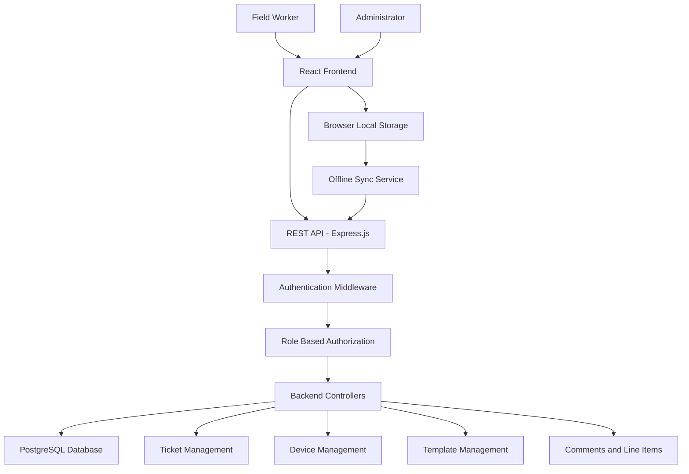

# Legacy OFS – System Architecture

## 1. Introduction

Legacy OFS is a Field Ticketing and Inspection Management Application designed for oilfield service operations.

It enables Field Workers to create, manage, and submit service tickets. Administrators can review submitted tickets, manage devices, configure templates, and control ticket statuses.

The system also supports offline ticket operations and synchronization when internet connectivity is restored.

## 2. System Architecture

The application follows a three-tier architecture:

1. **Presentation Layer:** React.js and Vite frontend.
2. **Application Layer:** Node.js and Express.js backend.
3. **Data Layer:** PostgreSQL database.

The frontend communicates with the backend through REST APIs. The backend validates requests, applies business logic, and interacts with PostgreSQL.

## 3. Architecture Diagram

## 4. Frontend Architecture

**Technology:** React.js and Vite

The frontend provides the user interface and handles user interactions.

Main modules:

- Login and Registration
- Worker Dashboard
- Admin Dashboard
- Create Ticket
- My Tickets
- Ticket Details
- Comments and Line Items
- Device Management
- Template Management
- Offline Tickets
- Offline Sync Service

The frontend uses React components and services to communicate with backend REST APIs.

## 5. Backend Architecture

**Technology:** Node.js and Express.js

The backend processes application requests and implements business logic.

Main modules:

- Authentication and Authorization
- Ticket Management
- Comment Management
- Ticket History
- Line Item Management
- Device Management
- Template Management
- Offline Synchronization

Protected routes verify authentication tokens before allowing access to authorized operations.

## 6. Database Architecture

**Technology:** PostgreSQL

Database name: `legacy_ofs_db`

Main database tables:

| Table | Purpose |
|---|---|
| users | Stores user accounts and roles |
| tickets | Stores field service tickets |
| ticket_templates | Stores ticket templates |
| ticket_comments | Stores ticket comments |
| ticket_line_items | Stores service and material items |
| devices | Stores registered devices |
| ticket_history | Stores ticket activity history |

The backend connects to PostgreSQL through its database configuration.

## 7. Authentication and Authorization Flow

1. User enters login credentials.
2. Frontend sends credentials to the backend.
3. Backend verifies the credentials.
4. Backend generates an authentication token.
5. Frontend stores the token for authenticated requests.
6. Protected backend routes validate the token.
7. Administrator-only routes verify the user's role.

## 8. Ticket Management Flow

1. Field Worker logs in.
2. Worker selects an available ticket template.
3. Worker creates a ticket.
4. Ticket is saved with Draft status.
5. Worker can edit Draft or Rejected tickets.
6. Worker submits the ticket.
7. Administrator reviews the submitted ticket.
8. Administrator approves or rejects it.
9. Approved tickets can be marked Invoiced or Void.

## 9. Offline Synchronization Flow

1. Worker creates or updates a ticket without internet access.
2. The application saves ticket data in browser Local Storage.
3. Pending actions are maintained in a local synchronization queue.
4. The application detects when internet connectivity returns.
5. The Offline Sync Service sends pending actions to the backend.
6. Backend processes actions and checks duplicate identifiers.
7. Successful actions are removed from the pending queue.
8. Failed actions remain available for retry.
9. The frontend updates local ticket synchronization statuses.

## 10. Device Management Flow

1. A worker registers a device.
2. The backend associates the device with the user's account.
3. The application checks the active device limit.
4. Administrators can view registered devices.
5. Administrators can revoke active devices.

The intended maximum is five active devices per account.

## 11. Template Management Flow

1. Administrator creates a ticket template.
2. Administrator configures its fields.
3. Administrator updates or disables templates.
4. Workers retrieve available active templates.
5. Workers use those templates to create tickets.

## 12. Security

- JWT-based authentication.
- Role-based access control.
- Protected backend routes.
- Administrator-only operations.
- Password protection using the configured authentication implementation.
- Device registration and active-device restrictions.
- Environment variables for sensitive configuration.
- Secrets excluded from GitHub.

## 13. Technology Stack

| Component | Technology |
|---|---|
| Frontend | React.js, Vite |
| Backend | Node.js, Express.js |
| Database | PostgreSQL |
| API Communication | REST API |
| Authentication | JWT |
| Offline Storage | Browser Local Storage |
| Development Tools | VS Code, npm, pgAdmin |

## 14. Conclusion

The Legacy OFS architecture separates presentation, application, and data layers.

This modular structure supports ticket management, inspections, administrator operations, device management, and offline synchronization. It also provides a foundation for future improvements and maintenance.